<picture>
  <source media="(max-width: 600px)" srcset="assets/hero-mobile.svg">
  
</picture>

  <a href="https://omniaihello.com"><b>EXPLORE omniAI ↗</b></a> &nbsp; / &nbsp;
  <a href="https://github.com/ninglinLiu/script-to-video-skill"><b>VIDEO SKILL ↗</b></a> &nbsp; / &nbsp;
  <a href="docs/OPEN_SOURCE.md"><b>OPEN SOURCE ↗</b></a> &nbsp; / &nbsp;
  <a href="#contact"><b>CONTACT ↗</b></a>

**刘羽 / Yu Liu** · XJTLU, IoT Engineering · Shanghai / Remote 
I build **AI agents, full-stack products, creative developer tools and on-chain systems** — from business workflows to software people can use. 
专注 **Agent 应用、全栈产品与开源工程**，持续探索 AI × Web3、金融数据与代码驱动的视觉表达。

### Contact

**EMAIL · [x07514475479@gmail.com](mailto:x07514475479@gmail.com)** 
[Write in Gmail ↗](https://mail.google.com/mail/?view=cm&fs=1&to=x07514475479%40gmail.com) &nbsp; · &nbsp; **[LinkedIn ↗](https://www.linkedin.com/in/yu-liu-359521383/)** &nbsp; · &nbsp; **[X · @ninglin000 ↗](https://x.com/ninglin000)**

---

<a href="https://omniaihello.com">
<picture>
  <source media="(max-width: 600px)" srcset="assets/omniai-mobile.svg">
  
</picture>
</a>

### omniAI · 金融研究 Agent 与交互式学习产品

**1,000+ registered users · 从研究问题到有来源的回答，再到可体验的产品。**

<a href="https://omniaihello.com">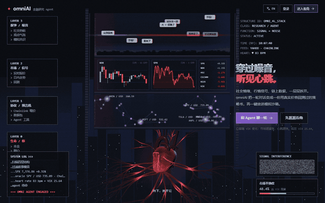</a>

- **Agent engineering** — RAG retrieval, bounded tool calling, streaming responses, structured output and shared MCP tools.
- **Product engineering** — bilingual Next.js experience, interactive Three.js workspace, market visualizations and research workflows.
- **My role** — project lead, product implementation, Agent integration and release iteration.

**[Live product →](https://omniaihello.com)** &nbsp; **[Source code →](https://github.com/ninglinLiu/infent-agent)** &nbsp; **[Agent internals →](https://github.com/ninglinLiu/infent-agent/tree/main/lib/ai)**

---

<a href="docs/OPEN_SOURCE.md">
<picture>
  <source media="(max-width: 600px)" srcset="assets/oss-atlas-mobile.svg">
  
</picture>
</a>

### Selected engineering contributions · 代表性开源贡献

| Upstream | Contribution | Merged PR |
| :--- | :--- | :---: |
| **Microsoft Agent Framework** | Correct Anthropic cached-input token accounting; restore consistent usage metrics across providers. | [#9859](https://github.com/microsoft/agent-framework/pull/9859) |
| **Apache Arrow** | Merge dictionary arrays without panicking on dictionary-key overflow; add regression coverage. | [#11925](https://github.com/apache/arrow-rs/pull/11925) |
| **LiveKit** | Restore E2EE data-packet decryption after key rotation; fix the retry path and its tests. | [#2188](https://github.com/livekit/client-sdk-js/pull/2188) |
| **Foundry** | Detect integer overflow during amount-unit conversion and return a typed error. | [#283](https://github.com/foundry-rs/foundry-core/pull/283) |
| **Pipecat** | Preserve Chinese and Japanese sentence boundaries in streamed context chunking. | [#6413](https://github.com/pipecat-ai/pipecat/pull/6413) |
| **AG2** | Expose Anthropic OpenTelemetry configuration through the framework's typed configuration. | [#3519](https://github.com/ag2ai/ag2/pull/3519) |
| **CrossGL / CrossTL** | Contribute fixes and tests across shader/compiler backends, including WGSL, HLSL, CUDA, HIP and Metal. | [Merged work](https://github.com/CrossGL/crosstl/pulls?q=is%3Apr+author%3AninglinLiu+is%3Amerged) |

**Full contribution archive** — engineering fixes, tests, refactors, API examples and documentation across the AI, data and Web3 ecosystem. 
功能修复、测试、重构与文档贡献，逐项链接上游记录。

**[Browse every merged contribution →](docs/OPEN_SOURCE.md)** &nbsp; **[Live GitHub activity →](https://github.com/search?q=is%3Apr+author%3AninglinLiu+is%3Amerged+-user%3AninglinLiu&type=pullrequests)**

Snapshot: 2026-11-07 · merged PRs authored by ninglinLiu · own repositories excluded.

---

<a href="https://github.com/ninglinLiu/script-to-video-skill">
<picture>
  <source media="(max-width: 600px)" srcset="assets/video-pipeline-mobile.svg">
  
</picture>
</a>

<a href="https://ninglinliu.github.io/script-to-video-skill/examples/binance-1029/">
  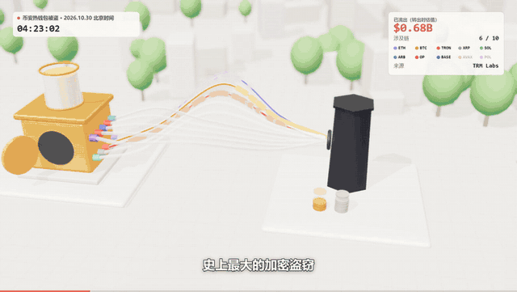
</a>

### Script to Video · 让 Agent 把文章做成知识动画

**A creative engineering toolkit: research → script → voice → 3D scenes → rendered video.**

- **Motion as code** — Three.js scenes, reusable action components, camera choreography and frame-by-frame rendering.
- **A complete production workflow** — evidence research, narration timing, subtitles, visual review and editable project delivery.
- **A reusable Agent Skill** — a compact entry point, on-demand references, production tools and a growing library of examples.

**[Watch the showcase →](https://ninglinliu.github.io/script-to-video-skill/examples/binance-1029/)** &nbsp; **[Explore the code →](https://github.com/ninglinLiu/script-to-video-skill)** &nbsp; **[Skill entry →](https://github.com/ninglinLiu/script-to-video-skill/blob/main/SKILL.md)**

---

### More AI engineering · 从业务流程到研究工具

| Project | What I build | Explore |
| :--- | :--- | :--- |
| **Business Bid Agent** | Business-document workflows: requirement extraction, local knowledge retrieval, structured drafting and DOCX delivery. Developed through an internal business internship. | Private business project |
| **Xfinresearch Lab** | Financial research Agent with source tracking, deterministic tools, structured reports and strategy comparison. | [Repository](https://github.com/ninglinLiu/Xfinresearch-lab) |
| **ETF / CIO Reliability** | Event-driven backtesting, execution contracts, independently reconciled ledgers and CLI integration checks. | [Repository](https://github.com/ninglinLiu/etf-cio-reliability) |
| **LLM Werewolf Arena** | Multi-agent experimentation with personas, role-specific behavior and private memory isolation. | [Repository](https://github.com/ninglinLiu/AI-llm-werewolf-arena-) |

---

<picture>
  <source media="(max-width: 600px)" srcset="assets/web3-mobile.svg">
  
</picture>

### Web3 · Data & Trading Systems · 链上工程与交易系统

| Project | Focus | Stack |
| :--- | :--- | :--- |
| **[EATLQ](https://github.com/ninglinLiu/eatlq-public)** | On-chain data, crypto research and trading-system engineering. | Python · SQL · EVM · ClickHouse |
| **[Solana Shadow Hunter](https://github.com/ninglinLiu/-solana-shadow-hunter)** | Copy-trading pipeline, event deduplication, risk circuit breakers and Telegram alerts. | Python · Solana · Jupiter |
| **[zkParallel / zkhahaha](https://github.com/ninglinLiu/zkhahaha)** | Parallel ZK batch-verification experiments on Monad Testnet. | Solidity · Hardhat · Next.js |
| **[EdgeNet.AI](https://github.com/ninglinLiu/edgenetai)** | Verifiable decentralized AI inference and Proof-of-Inference prototyping. | Solidity · TypeScript · DePIN |
| **[On-chain Data Copyright](https://github.com/ninglinLiu/onchain-data-copyright-saas)** | Dataset licensing, tokenized receipts and on-chain provenance. | Solidity · ERC-721 · IPFS |
| **[ShrimpNest](https://github.com/ninglinLiu/ShrimpNest)** | Solana on-chain analytics and intelligence pipeline. | TypeScript · Solana |

<b>More projects & hackathon builds ↗</b>

- [RiskLights](https://github.com/ninglinLiu/RiskLights-AI-driven-Crypto-Market-Risk-Radar-with-Automated-Alerts) — crypto, macro and on-chain risk signals.
- [Alpha Radar](https://github.com/ninglinLiu/awsome-alpha-radar-crypto-intelligence) — crypto intelligence aggregation.
- [QuantLab](https://github.com/ninglinLiu/quantlab-trading1.0) — technical analysis and backtesting tools.
- [Info Aggregator](https://github.com/ninglinLiu/info-aggregator) — multi-source information pipeline.
- [Hello Storage](https://github.com/ninglinLiu/hello-storage-dapp) · [Monad Counter](https://github.com/ninglinLiu/monad-counter-dapp1.0) — on-chain application experiments.
- [Cyberpunk Pac-Man](https://github.com/ninglinLiu/cyberpunk-pacman-game-hihihi) · [Group86 Pac-Man](https://github.com/ninglinLiu/group86-Pac-Man-project) — game projects.

---

<picture>
  <source media="(max-width: 600px)" srcset="assets/stack-mobile.svg">
  
</picture>

### Core Tech Stack

**Python · Java · TypeScript · Solidity**

| Area | Technologies |
| :--- | :--- |
| **AI & Agents** | RAG · Tool Calling · MCP · SSE · JSON Schema |
| **Web & Visualization** | React · Next.js · Tailwind CSS · Three.js |
| **Data & Research** | pandas · NumPy · SQL · ClickHouse · Redis · SQLite |
| **Engineering & Delivery** | Linux · Docker · Git · CI/CD |

---

<a href="https://github.com/ninglinLiu?tab=overview">
<picture>
  <source media="(max-width: 600px)" srcset="assets/activity-mobile.svg">
  
</picture>
</a>

<picture>
  <source media="(max-width: 600px)" srcset="assets/languages-mobile.svg">
  
</picture>

### Topics & Ecosystem

<picture>
  <source media="(max-width: 600px)" srcset="assets/topics-mobile.svg">
  
</picture>

[Ethereum](https://ethereum.org) · [Solana](https://solana.com) · [Base](https://base.org) · [Robinhood Chain](https://docs.robinhood.com/chain/) · [Arc](https://www.arc.io) · [Circle](https://www.circle.com) · [Chainlink](https://chain.link) · [Binance](https://www.binance.com) · [OKX](https://www.okx.com)

---

  <b>LET'S BUILD SOMETHING WORTH OPENING.</b>  
  AI Agent development · Full-stack engineering · Web3 data & trading systems  
  <a href="mailto:x07514475479@gmail.com"><b>x07514475479@gmail.com</b></a>  
  <a href="https://www.linkedin.com/in/yu-liu-359521383/">LinkedIn</a> &nbsp; / &nbsp;
  <a href="https://x.com/ninglin000">X · @ninglin000</a> &nbsp; / &nbsp;
  <a href="https://omniaihello.com">omniAI</a>

